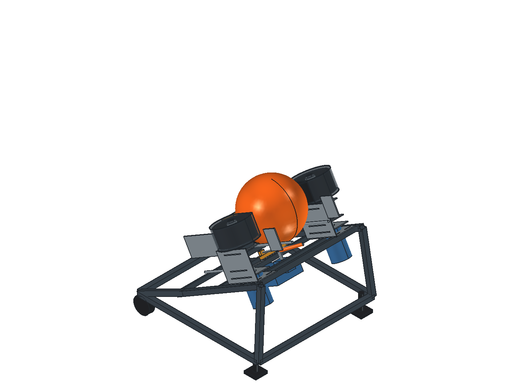

# 七号球极简发球机 V2

一颗标准七号球循环使用的篮球回收发球机工程方案。篮球落入单球托位，由推球片送入两只对转弹性轮的夹口，经轮组加速后沿固定30°方向射出。

主机布置包络约593×562×545mm，不含展开网架。集球网架展开口1800×1600mm、高约2700mm。模型没有多球储仓、多球挡爪或长出球槽。

这是工程布置和运动演示，尚未制作实物。抓球能力、出球速度、温升、强度和稳定性仍需样机测试；动画不是轮胎接触动力学验证。

## 在 FreeCAD 中打开和播放

当前脚本针对本机 Windows / FreeCAD 1.1.4，工作路径固定为 `D:/basketball`。移动仓库后须同步调整宏及脚本中的路径。

1. 打开 `七号球极简发球机_V2.FCStd`。
2. 进入“宏 → 宏”，用户宏位置设为 `D:/basketball`。
3. 选择 `MinimalLauncherV2.FCMacro`，点击“执行”。
4. 宏会自动循环演示，并在右上方显示置顶的“V2 单球发球演示”控制窗。可播放、暂停、复位、拖动进度，或切换机构近景和整机视图。

宏会识别已打开的V2模型，也可自动打开模型。控制器使用独立持久模块，避免宏执行结束后窗口或回调失效；启动错误写入 `minimal_v2/macro_startup.log`。

## 文件

| 文件 | 内容 |
|---|---|
| `七号球极简发球机_V2.FCStd` | 可编辑的FreeCAD工程布局 |
| `MinimalLauncherV2.FCMacro` | 实际播放入口，自动循环 |
| `minimal_v2/design.json` | 球径、轮径、轮隙、转速、推球行程等参数 |
| `minimal_v2/build_model.py` | 在FreeCAD内重建模型、计算能量并检查名义球路 |
| `minimal_v2/player.py` | 球、轮组、曲柄连杆和推球片的运动演示 |
| `minimal_v2/verify_path.py` | 三种球径、飞行出口、网面及轮组刚性净空检查 |
| `minimal_v2/verify_feeder.py` | 推球片和曲柄连杆的运动干涉检查 |
| `minimal_v2/test_macro_menu.py` | 通过FreeCAD原生“执行宏”菜单测试启动 |
| `minimal_v2/finish_gui.py` | 保存复位模型、机构预览并启动演示 |
| `minimal_v2/verification.json` | 净空及条件性力学估算结果 |
| `minimal_v2/native_macro_verification.json` | 原生菜单启动及播放、暂停、复位测试记录 |
| `minimal_v2/设计说明与样机清单.md` | 受力依据、材料预算及样机验证事项 |

上述建模及检查脚本需要FreeCAD运行环境，不应使用普通Python直接运行。

## 已完成的验证

- 239、245、248mm三种球径，共309个下落、供球和离轮飞行位置，未发现刚性干涉。
- 两只发球轮与固定结构之间未发现刚性相交。
- 推球机构19个曲柄姿态未发现与固定结构的刚性干涉。
- FreeCAD原生宏菜单实际启动成功，自动循环及播放、暂停、复位按钮验证通过。

名义球径245mm、初始轮隙232mm、轮径140mm、目标转速1400rpm。按球质量0.65kg、目标速度8m/s计算，球平动能约20.8J，两轮名义储能约94J。实际轮面硬度、压缩力及摩擦系数须实测后确定轮隙。

本仓库仅记录V2；旧版模型、工具环境、备份、临时截图、渲染帧和运行日志保留在本地且不纳入提交。
